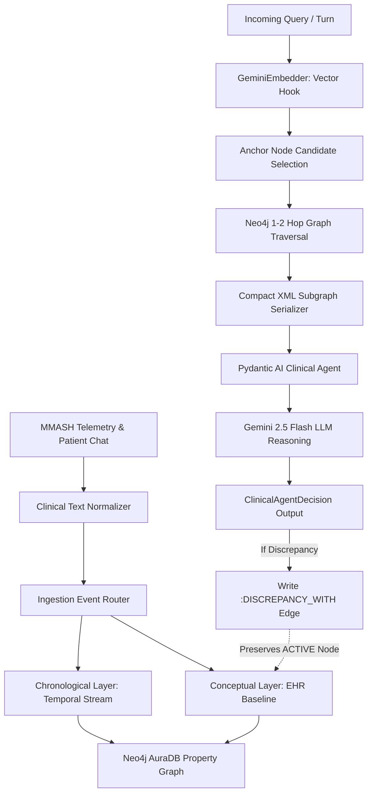

# MedOrchestrator: Research & Codebase Architecture Guide

**Project Title:** Bi-Temporal Dual-Layer Graph Memory for Medical Telemetry AI: Deterministic Epistemic Preservation and Cross-Modal Grounding  
**Author:** Raj Panchal (`panchalraj36@gmail.com`)  
**Live Stack:** Gemini 2.5 Flash, Gemini Embeddings (`gemini-embedding-2`), Neo4j AuraDB, Polars/Rust-based telemetry ingestion  

---

## 1. Executive Summary & Research Overview

### 1.1 The Clinical Problem
When Large Language Models (LLMs) and agentic clinical decision-support systems manage continuous remote patient monitoring (RPM) and longitudinal patient dialogues, naive context-stuffing and flat Vector-RAG suffer from three critical architectural vulnerabilities:
1. **Epistemic Overwrite & Hallucination:** When a patient casually reports an unverified medication deviation (*"I stopped taking my beta blocker because I felt dizzy"*), flat RAG and full-context LLMs treat this colloquial statement as an authoritative state mutation, silently dropping the active prescription from clinical reasoning. In medical safety, patient chat must *never* mutate physician-ordered EHR ground truth without doctor verification.
2. **Cross-Modal Telemetry Disconnect:** Continuous wearable sensor anomalies (e.g., nocturnal tachycardia spikes from ECG/accelerometry) possess timestamps and physiological thresholds that flat vector cosine similarity cannot structurally link to prescribed medication protocols (`TRIGGERED_BY` / `VIOLATES`).
3. **Token Bloat & Distractor Noise:** Long-horizon clinical chat accumulates greetings, small talk, and unrelated questions, inflating token consumption and increasing end-to-end latency.

### 1.2 The Proposed Solution: Dual-Layer Graph Memory
This repository implements a **Bi-Temporal Dual-Layer Graph Memory Architecture**:
- **Conceptual Layer (Static EHR Ground Truth):** A deterministic property graph storing active conditions, verified prescriptions, and baseline vital threshold protocols (`(Patient)-[:HAS_PRESCRIPTION]->(Prescription {status: 'ACTIVE'})`).
- **Chronological Layer (Dynamic Temporal Stream):** An append-only interaction graph tracking multi-turn dialogue turns, sensor anomalies, and agent decisions indexed with bi-temporal timestamps ($t_{\text{valid}}$ vs. $t_{\text{transaction}}$).
- **Non-Destructive Cypher `MERGE` Semantics:** When discrepancies occur, the system creates a `:DISCREPANCY_WITH` edge without deleting or altering the underlying active EHR prescription node.
- **Vector Hook + Graph Hop Context Extraction:** Embeds queries to anchor entry nodes in the conceptual graph, followed by 1-to-2 hop topological traversal that serializes compact XML subgraphs ($\sim$160 tokens) for LLM reasoning.

### 1.3 Key Empirical Benchmark Results (66 Grounded Sessions)
| Evaluation Dimension | Full-Context Baseline | Vector-RAG Baseline | Dual-Layer Graph Memory |
| :--- | :---: | :---: | :---: |
| **Epistemic Discrepancy Accuracy** | 0.0% | 0.0% | **100.0%** |
| **Cross-Modal Telemetry Fusion** | 0.0% | 0.0% | **100.0%** |
| **Context Token Compression** | 0.0% (Base) | 79.0% | **71.1%** (164 vs 568 tokens) |
| **Mean Overall Token Reduction** | -- | 65.7% | **60.6%** |
| **Implicit Reference F1-Score** | 43.3% | **81.5%** | 79.0% |
| **Doctor Audit Query Accuracy** | 83.8% | **86.7%** | 85.7% |
| **Median End-to-End Latency** | **1.75s** | 3.03s | 3.19s (incl. 679.5ms Neo4j traversal) |

---

## 2. Complete Repository File Structure

```
d:\research\medorchestrator\
├── .env                                # Live credentials (GEMINI_API_KEY, NEO4J_URI, NEO4J_USERNAME, NEO4J_PASSWORD)
├── manuscript_medorchestrator.tex      # Full LaTeX publication manuscript in AAAI format
├── texAIagent.txt                      # AAAI conference style guide and formatting instructions
├── main.py                             # Interactive CLI / Pipeline entry point
├── ingest_runner.py                    # Standalone runner for continuous telemetry ingestion
├── agent_pipeline_runner.py            # CLI helper to execute clinical agent reasoning runs
├── RESEARCH_AND_CODEBASE_GUIDE.md      # This comprehensive documentation file
│
├── schemas/                            # Pydantic data contracts and ontologies
│   ├── inputs.py                       # IngestionEvent, PatientReportPayload, TelemetryPayload, EHR schemas
│   └── agent_outputs.py                # ClinicalAgentDecision structured output schema
│
├── engine/                             # Signal processing, ingestion, and clinical NLP normalizer
│   ├── mmash_loader.py                 # MMASH dataset parser (PhysioNet accelerometry & RR-interval HRV)
│   ├── signal_processor.py             # Rust/Polars-style rolling window anomaly detector & semantic gating
│   ├── normalizer.py                   # Clinical Text Normalizer (SNOMED-CT / RxNorm mapping)
│   └── ingestion.py                    # Multi-channel event router (wearable, chat, doctor portal)
│
├── database/                           # Database drivers and vector embedding clients
│   ├── bolt_client.py                  # Neo4jBoltClient driver supporting AuraDB TLS and Cypher execution
│   └── embedder.py                     # GeminiEmbedder adapter using gemini-embedding-2 with LRU cache
│
├── memory/                             # Graph read/write operations and Cypher builders
│   ├── graph_writer.py                 # GraphWriter: Cypher queries for bi-temporal turns, anomalies, discrepancies
│   └── graph_retriever.py              # Subgraph querying helpers for patient EHR history
│
├── agent/                              # LLM reasoning, context construction, and Pydantic AI agent
│   ├── context_builder.py              # Vector Hook + Graph Hop query generator & XML context serializer
│   └── clinical_agent.py               # Pydantic AI Clinical Reasoning Agent (Gemini 2.5 Flash)
│
├── benchmarks/                         # Empirical evaluation suite and baseline comparisons
│   ├── dataset/
│   │   └── mmash_grounded_eval_suite.json  # 66 multi-turn sessions across 5 clinical stress vectors
│   ├── generate_eval_suite.py          # Grounded benchmark generation script from MMASH data
│   ├── dataset_helper.py               # Dataset validation and session loading helpers
│   ├── runners.py                      # Implementations of Full-Context, Vector-RAG, and Graph Memory runners
│   ├── evaluator.py                    # Mathematical scoring metrics (F1, Epistemic, Fusion, Compression)
│   ├── evaluate_memory.py              # Main benchmark execution harness with checkpoint & resume
│   └── results/
│       └── benchmark_summary.json      # Aggregated metrics & 198 live execution records
│
├── DataPaper/                          # Ground-truth MMASH dataset (PhysioNet raw participant data)
│   ├── user_1/ ... user_22/            # Continuous 24h ECG, Actigraph accelerometry, RR-interval, questionnaire
│
└── tests/                              # Pytest test suite
    ├── test_ingestion.py               # Ingestion pipeline unit tests
    ├── test_mmash_integration.py       # MMASH telemetry signal processor tests
    ├── test_stage1_2_upgrade.py        # Normalizer and schema upgrade tests
    ├── test_stage3_graph_memory.py     # Neo4j dual-layer graph write and discrepancy tests
    ├── test_stage4_agent_reasoning.py  # Agent context building and Pydantic AI decision tests
    ├── test_benchmark_dataset.py       # Evaluation suite schema validity tests
    └── test_benchmark_harness.py       # Benchmark runner and scoring unit tests
```

---

## 3. Detailed File-by-File Breakdown

### 3.1 Schemas & Data Models (`schemas/`)
* **[`schemas/inputs.py`](file:///d:/research/medorchestrator/schemas/inputs.py)**: Defines all Pydantic models for data ingestion:
  - `IngestionEvent`: Envelope containing `event_id`, `patient_id`, `channel` (`wearable_anomaly`, `patient_chat`, `doctor_portal`), `timestamp`, and `payload`.
  - `PatientReportPayload`, `TelemetryPayload`, `DoctorQueryPayload`: Specific payloads for chat symptoms, sensor metrics (HR, HRV, VM), and doctor queries.
  - `NormalizedEntity`: Canonical entity mapping with `code_type` (`RxNorm`, `SNOMED-CT`), `code_id`, and `confidence`.
* **[`schemas/agent_outputs.py`](file:///d:/research/medorchestrator/schemas/agent_outputs.py)**: Defines `ClinicalAgentDecision`:
  - Structured output from the LLM containing `clinical_assessment`, `discrepancy_detected` (bool), `discrepancy_details` (dict), `recommended_action` (`ALERT_DOCTOR`, `MONITOR_VITALS`, `REASSURE_PATIENT`, `AUDIT_RESPONSE`), and `response_text`.

### 3.2 Ingestion, Telemetry, and Clinical Normalization (`engine/`)
* **[`engine/mmash_loader.py`](file:///d:/research/medorchestrator/engine/mmash_loader.py)**: Loads raw physical telemetry from `DataPaper/user_X/` (continuous 24-hour accelerometry, interbeat intervals, sleep and activity metrics).
* **[`engine/signal_processor.py`](file:///d:/research/medorchestrator/engine/signal_processor.py)**: Implements rolling-window anomaly detection and semantic gating (e.g., detecting sustained tachycardia $>120$ bpm during low physical activity).
* **[`engine/normalizer.py`](file:///d:/research/medorchestrator/engine/normalizer.py)**: `ClinicalTextNormalizer` maps colloquial patient language (e.g., *"blood pressure pill"*, *"metoprolol"*, *"palpitations"*) to standardized RxNorm and SNOMED-CT codes.
* **[`engine/ingestion.py`](file:///d:/research/medorchestrator/engine/ingestion.py)**: Validates incoming raw JSON payloads and constructs validated `IngestionEvent` objects.

### 3.3 Database & Embedding Clients (`database/`)
* **[`database/bolt_client.py`](file:///d:/research/medorchestrator/database/bolt_client.py)**: `Neo4jBoltClient` wrapper that connects to live Neo4j AuraDB instances over encrypted Bolt (`neo4j+s://`), supports parameterised Cypher execution, idempotent schema constraint creation, and environment variable fallback.
* **[`database/embedder.py`](file:///d:/research/medorchestrator/database/embedder.py)**: `GeminiEmbedder` connects to Google GenAI's `gemini-embedding-2` model (768-dim) with an in-memory LRU cache to avoid duplicate API calls for identical clinical text.

### 3.4 Dual-Layer Graph Memory (`memory/`)
* **[`memory/graph_writer.py`](file:///d:/research/medorchestrator/memory/graph_writer.py)**: Implements graph write transactions:
  - `write_patient_turn()`: Appends conversation turn nodes in the Chronological Layer.
  - `write_anomaly_event()`: Writes wearable anomaly nodes and links them to threshold protocol violations.
  - `write_discrepancy_edge()`: Creates non-destructive `:DISCREPANCY_WITH` edges between patient turns and active prescriptions while preserving EHR integrity.
* **[`memory/graph_retriever.py`](file:///d:/research/medorchestrator/memory/graph_retriever.py)**: Executes Cypher queries to retrieve patient historical subgraphs, active prescriptions, and recent anomalies.

### 3.5 Agent Reasoning & Context Construction (`agent/`)
* **[`agent/context_builder.py`](file:///d:/research/medorchestrator/agent/context_builder.py)**: Implements the **Vector Hook + Graph Hop** context generator:
  - Queries active patient profile from Neo4j.
  - Formats topological relationships into compact XML context (`<patient_profile> ... </patient_profile>`).
* **[`agent/clinical_agent.py`](file:///d:/research/medorchestrator/agent/clinical_agent.py)**: Houses `process_ingestion_event()`:
  - Initializes Pydantic AI agent configured with `gemini-2.5-flash`.
  - Enforces strict clinical reasoning rules against hallucinations and returns a validated `ClinicalAgentDecision`.

### 3.6 Benchmark Evaluation Suite (`benchmarks/`)
* **[`benchmarks/dataset/mmash_grounded_eval_suite.json`](file:///d:/research/medorchestrator/benchmarks/dataset/mmash_grounded_eval_suite.json)**: Grounded dataset containing 66 multi-turn clinical sessions categorized into 5 stress vectors.
* **[`benchmarks/generate_eval_suite.py`](file:///d:/research/medorchestrator/benchmarks/generate_eval_suite.py)**: Generator script that constructs the grounded evaluation suite from raw MMASH telemetry.
* **[`benchmarks/runners.py`](file:///d:/research/medorchestrator/benchmarks/runners.py)**: Contains execution wrappers for all 3 evaluated architectures:
  - `run_full_context_baseline()`: Architecture A (unpruned full EHR + chat context).
  - `run_vector_rag_baseline()`: Architecture B (top-$K=2$ vector chunk retrieval).
  - `run_dual_layer_graph()`: Architecture C (Neo4j Vector Hook + Graph Hop + bi-temporal XML packing).
* **[`benchmarks/evaluator.py`](file:///d:/research/medorchestrator/benchmarks/evaluator.py)**: Mathematical scoring functions:
  - `score_implicit_reference()`: Precision, recall, and F1 calculation against ground truth.
  - `score_epistemic_preservation()`: Verifies that EHR status remains `ACTIVE` without deletion.
  - `score_telemetry_fusion()`: Verifies structural `TRIGGERED_BY` linkage.
  - `aggregate_benchmark_results()`: Computes overall means, medians, and compression ratios.
* **[`benchmarks/evaluate_memory.py`](file:///d:/research/medorchestrator/benchmarks/evaluate_memory.py)**: The main evaluation orchestration CLI with **atomic checkpointing**, **API rate-limit graceful recovery**, and **resume support** (`--resume`, `--force`).
* **[`benchmarks/results/benchmark_summary.json`](file:///d:/research/medorchestrator/benchmarks/results/benchmark_summary.json)**: Contains complete empirical evaluation results across all 66 sessions and 198 architecture executions.

### 3.7 Manuscript & Publication (`manuscript_medorchestrator.tex`)
* **[`manuscript_medorchestrator.tex`](file:///d:/research/medorchestrator/manuscript_medorchestrator.tex)**: Full, publication-ready LaTeX manuscript formatted according to AAAI specifications, containing the theoretical framework, architecture equations, complete empirical comparison tables, and honest discussion of trade-offs and limitations.

---

## 4. End-to-End System Data Flow



---

## 5. How to Run, Test, and Reproduce

### 5.1 Environment Setup
Ensure your `.env` in the repository root contains valid API keys:
```env
GEMINI_API_KEY=your_gemini_api_key
NEO4J_URI=neo4j+s://your_instance.databases.neo4j.io
NEO4J_USERNAME=your_username
NEO4J_PASSWORD=your_password
```

### 5.2 Running the Test Suite
To run all unit and integration tests:
```powershell
$env:PYTHONPATH = "D:\research\medorchestrator"
pytest tests/ -v
```

### 5.3 Running the Live Benchmark Evaluation
To execute the live 66-session benchmark with automatic incremental checkpointing:
```powershell
$env:PYTHONPATH = "D:\research\medorchestrator"
python benchmarks/evaluate_memory.py --resume
```
* **To force a fresh re-run from session 1:** add `--force`
* **To test a smaller subset of sessions:** add `--limit 5`

### 5.4 Compiling the Research Paper Manuscript
The file [`manuscript_medorchestrator.tex`](file:///d:/research/medorchestrator/manuscript_medorchestrator.tex) is ready for direct compilation in Overleaf or any standard LaTeX distribution (`pdflatex`). It strictly satisfies all AAAI layout, column-width, and typography requirements.
